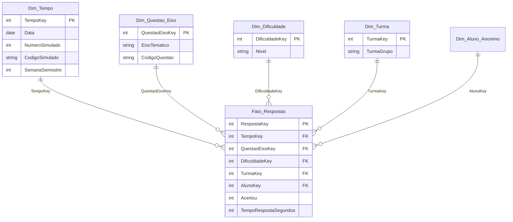

# BUSINESS INTELLIGENCE — PROJETO INTEGRADOR

## MODELO DE DADOS (DW)

### ENADE Analytics — Marco 2

Este documento é o entregável do Marco 2 do Projeto Integrador. Ele formaliza o
modelo dimensional construído para o banco de questões/respostas do simulado
ENADE. As seções 1 a 8 seguem o template oficial da disciplina. Preenchido com o
modelo efetivamente definido e materializado em `modelo-dimensional/` (SQL, DBML
e CSVs). A captura da visão **Modelo** do Power BI ainda deve ser colada na
Seção 3 após a implementação no Desktop.

| **Entrega**            | Até o final da Semana 8 (Marco 2)                                                                                        |
| ---------------------- | ------------------------------------------------------------------------------------------------------------------------ |
| **Equipe**             | RevelaDados                                                                                                              |
| **Integrantes**        | • Alessandro Sondey Rodrigues Lima   • João Luiz Vicente Junior   • Leandro Zeni                                   |
| **Base de referência** | [Termo de Abertura (Marco 0)](./marco-0.md) e [Matriz de Requisitos (Marco 1)](./marco-1.md) · Portaria Inep nº 171/2026 |
| **Data**               | 10 / 09 / 2026                                                                                                           |

---

## 1. Grão da tabela fato

Cada registro da `Fato_Respostas` representa **1 resposta, de 1 aluno anônimo, a
1 questão, em 1 tentativa/aplicação de simulado**.

Esse nível de detalhe permite analisar desempenho por eixo, turma/grupo e
período sem armazenar identificadores pessoais diretos. A taxa de acerto **não é
um fato armazenado**: é calculada na consulta
(`SUM(Acertou) / COUNT(respostas)`).

## 2. Esquema estrela implementado

Modelo alinhado ao **Guia do Projeto — Unidade 3 (Semana 7)** e materializado em
`modelo-dimensional/esquema-estrela.sql` e CSVs em `modelo-dimensional/powerbi/`.

| **Tabela (guia)** | **Campos principais** |
| --- | --- |
| Fato (`Fato_Respostas`) | `Acertou`; `TempoRespostaSegundos`; `TempoKey`; `QuestaoEixoKey`; `DificuldadeKey`; `TurmaKey`; `AlunoKey` (drill-down interno); `RespostaDada` |
| `Dim_Tempo` | `TempoKey`; `Data`; `NumeroSimulado`; `CodigoSimulado`; `SemanaSemestre`; `Ano`; `Mes`; `NomeMes` |
| `Dim_Questao_Eixo` | `QuestaoEixoKey`; `CodigoQuestao`; `EixoTematico`; `Enunciado` |
| `Dim_Dificuldade` | `DificuldadeKey`; `Nivel` (Fácil / Médio / Difícil) |
| `Dim_Turma` | `TurmaKey`; `TurmaGrupo` (sem nome, CPF ou e-mail) |
| `Dim_Aluno_Anonimo` | `AlunoKey`; `CodigoAlunoAnonimo`; `TurmaKey` — uso interno da equipe (RF04) |

Equivalência de nomes do guia: `id_tempo` → `TempoKey`; `id_questao_eixo` →
`QuestaoEixoKey`; `id_dificuldade` → `DificuldadeKey`; `id_turma` → `TurmaKey`.

Relacionamentos **1:\***, filtro **unidirecional** dimensão → fato. Operações
OLAP por pergunta do briefing: **Anexo D**.

`EixoTematico`: um dos 16 objetos do Art. 6º da Portaria Inep nº 171/2026
(Anexo B).

## 3. Diagrama do esquema estrela

**Entrega oficial:** colar aqui a captura de tela da visão **Modelo** do Power
BI (fato no centro, dimensões ao redor, linhas de relacionamento visíveis).

Arquivo previsto: `modelo-dimensional/diagrama-powerbi.png` (ainda não gerado —
depende da implementação no Power BI Desktop).

Diagrama conceitual equivalente, para conferência enquanto a captura não existe:

## 4. Dicionário de dados completo

| **Tabela**        | **Campo/Medida**      | **Tipo**      | **Descrição**                                                                         |
| ----------------- | --------------------- | ------------- | ------------------------------------------------------------------------------------- |
| Fato_Respostas    | RespostaKey           | Inteiro (PK)  | Chave técnica única de cada resposta registrada.                                      |
| Fato_Respostas    | TempoKey              | Inteiro (FK)  | Relaciona a resposta à Dim_Tempo.                                                     |
| Fato_Respostas    | AlunoKey              | Inteiro (FK)  | Relaciona a resposta ao aluno anonimizado.                                            |
| Fato_Respostas    | QuestaoEixoKey        | Inteiro (FK)  | Relaciona a resposta à questão / eixo temático.                                       |
| Fato_Respostas    | DificuldadeKey        | Inteiro (FK)  | Nível da questão respondida (snowflake do guia).                                      |
| Fato_Respostas    | TurmaKey              | Inteiro (FK)  | Turma/grupo agregado (sem PII).                                                       |
| Fato_Respostas    | RespostaDada          | Texto         | Alternativa/resposta registrada pelo participante.                                    |
| Fato_Respostas    | Acertou               | Inteiro (0/1) | Contador aditivo: 1 para resposta correta e 0 para incorreta.                         |
| Fato_Respostas    | TempoRespostaSegundos | Inteiro       | Tempo gasto na resposta, em segundos inteiros (sem decimal).                           |
| Dim_Tempo         | TempoKey              | Inteiro (PK)  | Chave substituta da dimensão de tempo (1, 2, …).                                       |
| Dim_Tempo         | Data                  | Data          | Data da aplicação/resposta.                                                           |
| Dim_Tempo         | Ano                   | Inteiro       | Ano da aplicação.                                                                     |
| Dim_Tempo         | Mes                   | Inteiro       | Número do mês.                                                                        |
| Dim_Tempo         | NomeMes               | Texto         | Nome do mês para agrupamentos e ordenação.                                            |
| Dim_Tempo         | SemanaSemestre        | Inteiro       | Semana do semestre, usada para acompanhar evolução temporal.                          |
| Dim_Aluno_Anonimo | AlunoKey              | Inteiro (PK)  | Chave substituta do participante no DW.                                               |
| Dim_Aluno_Anonimo | CodigoAlunoAnonimo    | Texto         | Código sem identificação direta (ex.: `Aluno_014`).                                   |
| Dim_Turma         | TurmaKey              | Inteiro (PK)  | Chave da turma/grupo.                                                                 |
| Dim_Turma         | TurmaGrupo            | Texto         | Nome do grupo (ex.: TGI Noturno A), sem identificar estudante.                        |
| Dim_Questao_Eixo  | QuestaoEixoKey        | Inteiro (PK)  | Chave substituta da questão.                                                          |
| Dim_Questao_Eixo  | CodigoQuestao         | Texto         | Identificador interno da questão.                                                     |
| Dim_Questao_Eixo  | EixoTematico          | Texto         | Objeto de conhecimento (Portaria Inep nº 171/2026, Art. 6º).                          |
| Dim_Questao_Eixo  | Enunciado             | Texto         | Texto da questão (opcional no guia).                                                  |
| Dim_Dificuldade   | DificuldadeKey        | Inteiro (PK)  | Chave do nível de dificuldade.                                                        |
| Dim_Dificuldade   | Nivel                 | Texto         | Fácil, Médio ou Difícil.                                                              |
| Dim_Tempo         | NumeroSimulado        | Inteiro       | Número da aplicação (simulado nº do guia).                                             |
| Dim_Tempo         | CodigoSimulado        | Texto         | Código do simulado (ex.: SIM-PILOTO-01).                                              |
| Dim_Tempo         | DescricaoSimulado     | Texto         | Descrição da aplicação.                                                               |
| Dim_Aluno_Anonimo | TurmaKey              | Inteiro (FK)  | Liga o participante anonimizado à `Dim_Turma`.                                        |
| Medida            | Total Respostas       | DAX           | `COUNTROWS(Fato_Respostas)`                                                           |
| Medida            | Total Acertos         | DAX           | `SUM(Fato_Respostas[Acertou])`                                                        |
| Medida            | Taxa de Acerto        | DAX           | `DIVIDE([Total Acertos], [Total Respostas], 0)`                                       |
| Medida            | Alunos Participantes  | DAX           | `DISTINCTCOUNT(Fato_Respostas[AlunoKey])`                                             |

## 5. Medidas DAX documentadas (mínimo de 3)

| **Nome da medida**   | **Fórmula DAX**                                 | **O que calcula**                                                           |
| -------------------- | ----------------------------------------------- | --------------------------------------------------------------------------- |
| Total Respostas      | `COUNTROWS(Fato_Respostas)`                     | Conta o total de respostas registradas no contexto de filtro.               |
| Total Acertos        | `SUM(Fato_Respostas[Acertou])`                  | Soma os acertos (1) das respostas selecionadas.                             |
| Taxa de Acerto       | `DIVIDE([Total Acertos], [Total Respostas], 0)` | Calcula a proporção de acertos por eixo, turma, simulado ou período.        |
| Alunos Participantes | `DISTINCTCOUNT(Fato_Respostas[AlunoKey])`       | Conta quantos alunos anônimos distintos participaram no contexto analisado. |

A mesma `Taxa de Acerto` responde às perguntas 1, 2 e 4 do briefing (eixo,
turma/grupo, evolução). `Alunos Participantes` apoia a pergunta 3 (lacunas
concentradas versus distribuídas), detalhada no [Marco 3](./marco-3.md).

## 6. Conformidade com a LGPD

Marcado com X o compromisso da equipe, referente ao que foi assumido no Marco 1:

- [x] Nenhuma dimensão do modelo contém nome, CPF, e-mail ou outro identificador
      direto do estudante.
- [x] Os dados foram anonimizados (código do aluno, não o dado original) antes
      da modelagem dimensional.
- [ ] O termo de consentimento (TCLE simplificado, Marco 1) foi aplicado a todos
      os participantes do simulado-piloto antes da coleta.

O terceiro item permanece aberto até a coleta real do simulado-piloto. O texto
do termo está em [termo-lgpd.md](./termo-lgpd.md). O seed em
`modelo-dimensional/powerbi/` já usa apenas `CodigoAlunoAnonimo` (ex.:
`Aluno_014`).

## 7. Rastreabilidade com a Matriz de Requisitos (Marco 1)

| **ID do requisito** | **Como este modelo atende ao requisito**                                                                                                                       |
| ------------------- | -------------------------------------------------------------------------------------------------------------------------------------------------------------- |
| RF01                | `Dim_Questao_Eixo` e `Dim_Dificuldade` classificam questões por eixo e nível.                                                                                    |
| RF02                | O fato `Acertou` (0/1), com `Dim_Questao_Eixo`, alimenta `Taxa de Acerto` por eixo.                                                                              |
| RF03                | `Dim_Turma.TurmaGrupo` permite comparar turmas sem identificar estudantes.                                                                                     |
| RF04                | `CodigoAlunoAnonimo` + `DISTINCTCOUNT` de `AlunoKey` permitem ver se as lacunas estão concentradas ou distribuídas, sem nome nominal. Detalhamento no Marco 3. |
| RF05                | `Dim_Tempo` (`NumeroSimulado`, `CodigoSimulado`) acompanha evolução entre aplicações.                                                                          |
| RF06                | `Fato_Respostas` registra cada resposta com eixo, dificuldade e turma no grão da Seção 1.                                                                      |
| RF08                | O esquema não expõe indivíduo identificável; o dashboard consome apenas agregações por turma/eixo.                                                             |
| RNF01               | Apenas `CodigoAlunoAnonimo`; não há nome, CPF, e-mail ou identificador direto nas dimensões analíticas.                                                        |
| RNF02               | A inclusão no dataset exige TCLE assinado; o checklist da Seção 6 registra a validação na coleta.                                                              |

RF07 (resumos executivos com IA) e RNF04 (usabilidade do dashboard) são
atendidos nos marcos seguintes; este DW fornece as métricas agregadas de
entrada.

---

## Anexo A — Quatro passos de Kimball (Semana 5)

| **Passo**               | **Decisão do projeto**                                                                                                                                           |
| ----------------------- | ---------------------------------------------------------------------------------------------------------------------------------------------------------------- |
| 1. Processo de negócio  | Avaliação do desempenho dos concluintes nos simulados preparatórios para o ENADE 2026 (prova em 29/11/2026), por eixo temático, turma/grupo, simulado e período. |
| 2. Granularidade (grão) | 1 resposta de 1 aluno anônimo a 1 questão em 1 tentativa/aplicação de simulado.                                                                                  |
| 3. Dimensões            | `Dim_Tempo`; `Dim_Questao_Eixo`; `Dim_Dificuldade`; `Dim_Turma`; `Dim_Aluno_Anonimo` (interno).                                                                  |
| 4. Fatos                | `Acertou` (0/1), `RespostaDada` e `TempoRespostaSegundos`. Taxa de acerto só na consulta.                                                                        |

## Anexo B — Eixos do componente específico (Portaria Inep nº 171/2026, Art. 6º)

Três níveis de dificuldade: Fácil, Médio e Difícil.

| **#** | **Eixo temático (Art. 6º)**              |
| ----- | ---------------------------------------- |
| I     | Algoritmos                               |
| II    | Arquitetura de computadores              |
| III   | Sistemas operacionais                    |
| IV    | Banco de dados                           |
| V     | Engenharia de software                   |
| VI    | Gerência de projetos                     |
| VII   | Gestão de pessoas                        |
| VIII  | Gestão dos serviços de TI                |
| IX    | Tecnologias para inteligência de negócio |
| X     | Governança de tecnologia da informação   |
| XI    | Gestão estratégica organizacional        |
| XII   | Processos organizacionais                |
| XIII  | Redes de computadores                    |
| XIV   | Segurança da informação                  |
| XV    | Sistemas de informações gerenciais       |
| XVI   | Ética, tecnologia e sociedade            |

O componente específico oficial tem 30 questões objetivas e 1 discursiva (Art.
3º). O seed do piloto usa 2 questões por eixo (32 objetivas) para cobrir os 16
objetos sem remodelar o grão.

## Anexo C — ETL / carga no Power BI

Ferramentas gratuitas apenas (RNF03): Microsoft Forms, planilhas e Power BI
Desktop.

1. **Extração** — banco de questões (eixo e dificuldade) em planilha; respostas
   via Forms. Seed de desenvolvimento: CSVs em `modelo-dimensional/powerbi/`
   (`python3 gerar_seed.py --demo`: 36 alunos, 6 turmas, 32 questões, 4
   simulados, 4.608 respostas). Perfil básico (2 turmas / 768 respostas):
   `gerar_seed.py` sem flags.
2. **Transformação** — TCLE como condição de inclusão (RNF02); substituir
   identificador original por `CodigoAlunoAnonimo`; gerar chaves `*Key`;
   calcular `Acertou` (0/1) pelo gabarito; montar `Dim_Tempo` pela data.
3. **Carga** — Power BI Desktop: Obter dados → pasta
   `modelo-dimensional/powerbi/` (`Dim_Dificuldade`, `Dim_Turma`, `Dim_Tempo`,
   `Dim_Questao_Eixo`, `Dim_Aluno_Anonimo`, `Fato_Respostas`); relacionamentos
   1:\*; medidas da Seção 5. Tutorial: [`powerbi/tutorial-marco-3.md`](./powerbi/tutorial-marco-3.md).

Arquivos: [`esquema-estrela.sql`](./modelo-dimensional/esquema-estrela.sql) ·
[`esquema-estrela.dbml`](./modelo-dimensional/esquema-estrela.dbml) ·
[`gerar_seed.py`](./modelo-dimensional/gerar_seed.py)

## Anexo D — OLAP e perguntas da coordenação (Guia Semana 7)

| **Pergunta da coordenação** | **Operação OLAP** | **Interpretação no ENADE Analytics** |
| --- | --- | --- |
| Quais eixos têm o pior desempenho médio? | **Slice / roll-up** por eixo | Barras com `[Taxa de Acerto]` por `EixoTematico`; eixos abaixo de 50% = lacuna crítica. |
| Diferença entre turmas ou grupos? | **Dice / slice** por turma | Colunas com `Dim_Turma[TurmaGrupo]`; diferença &lt; 2 pp = decisão pode ignorar turma. |
| Lacunas concentradas em poucos estudantes? | **Drill-down** aluno anônimo (interno) | Equipe usa `CodigoAlunoAnonimo` + clusters; **dashboard da coordenação** mostra só faixas / `% abaixo 50%` (RF08). |
| Desempenho melhora ao longo do semestre? | **Drill-down / roll-up** em `Dim_Tempo` | Comparar `CodigoSimulado` ou `NumeroSimulado`; olhar eixos que não evoluem apesar da média subir. |
